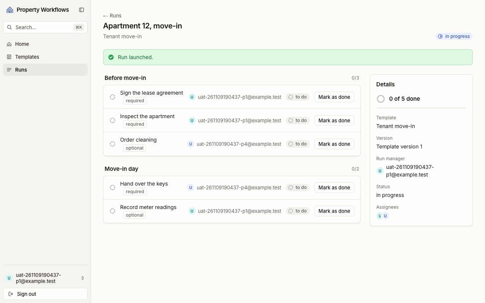
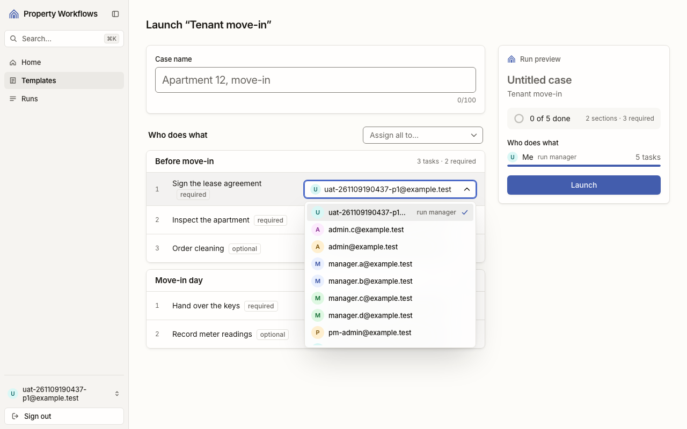
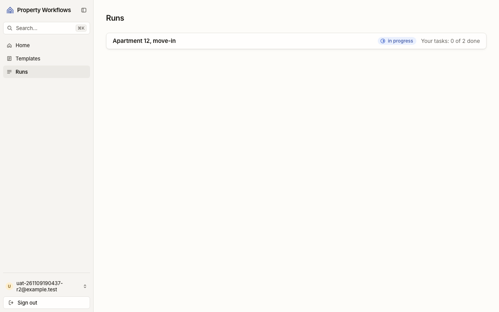
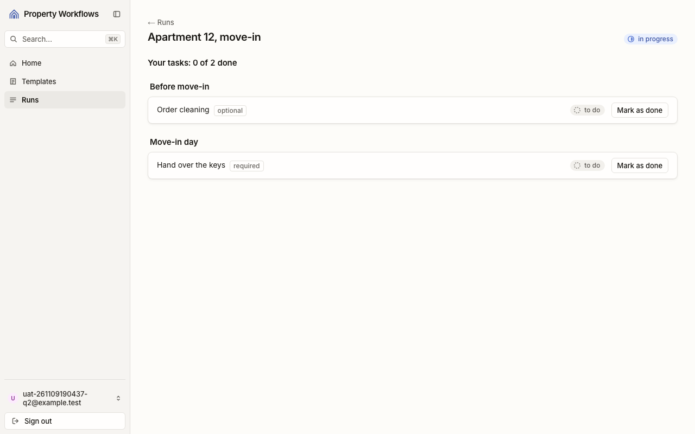
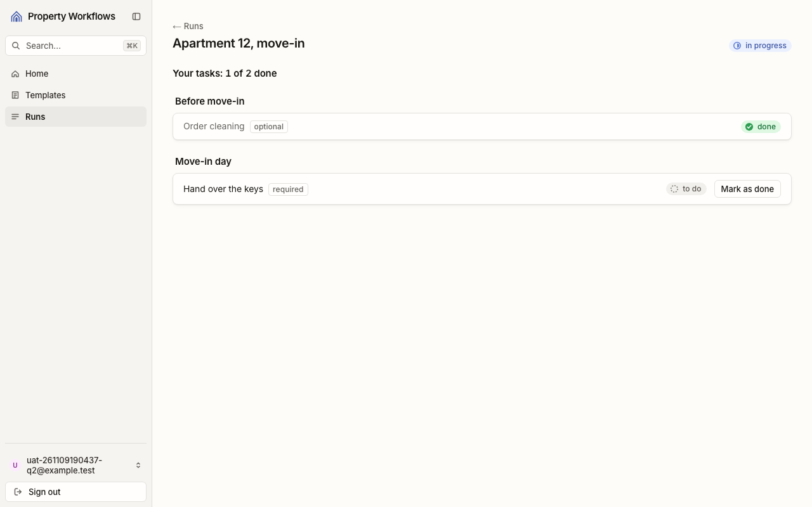
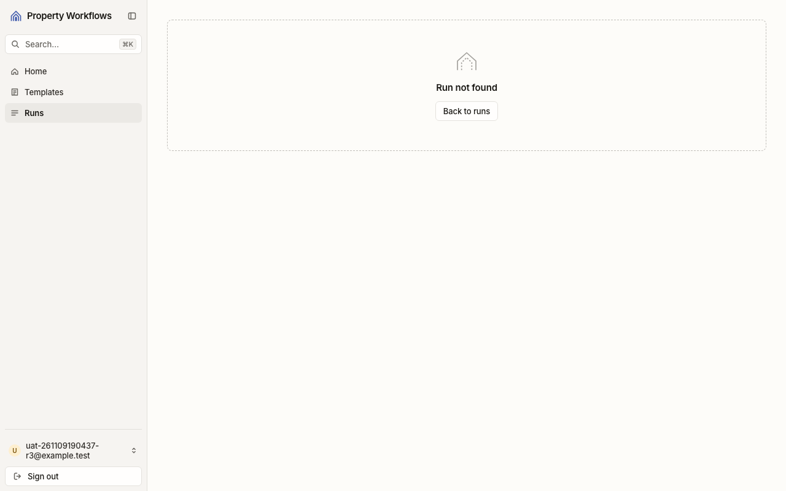
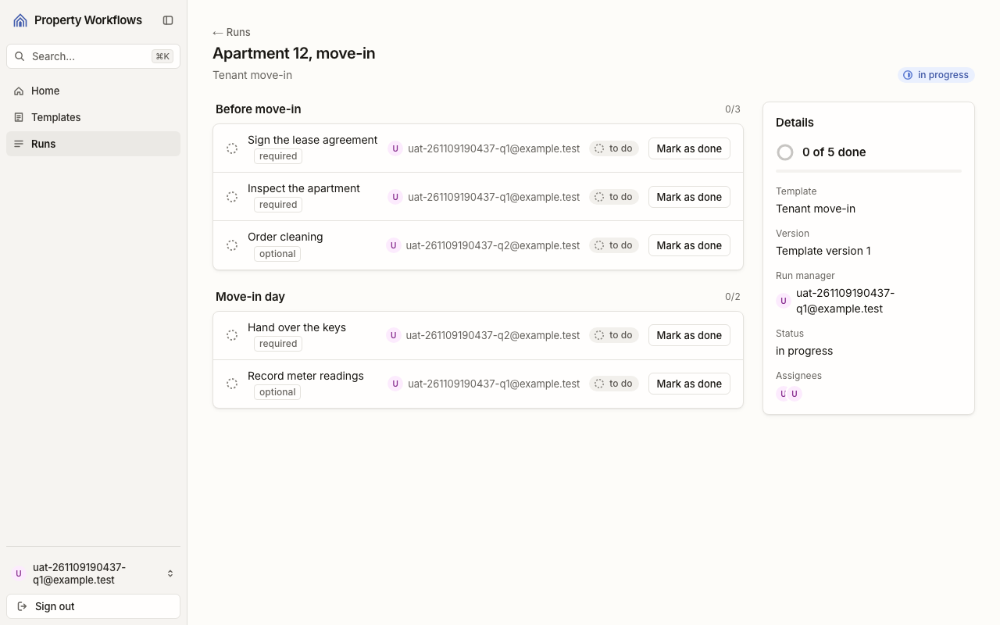
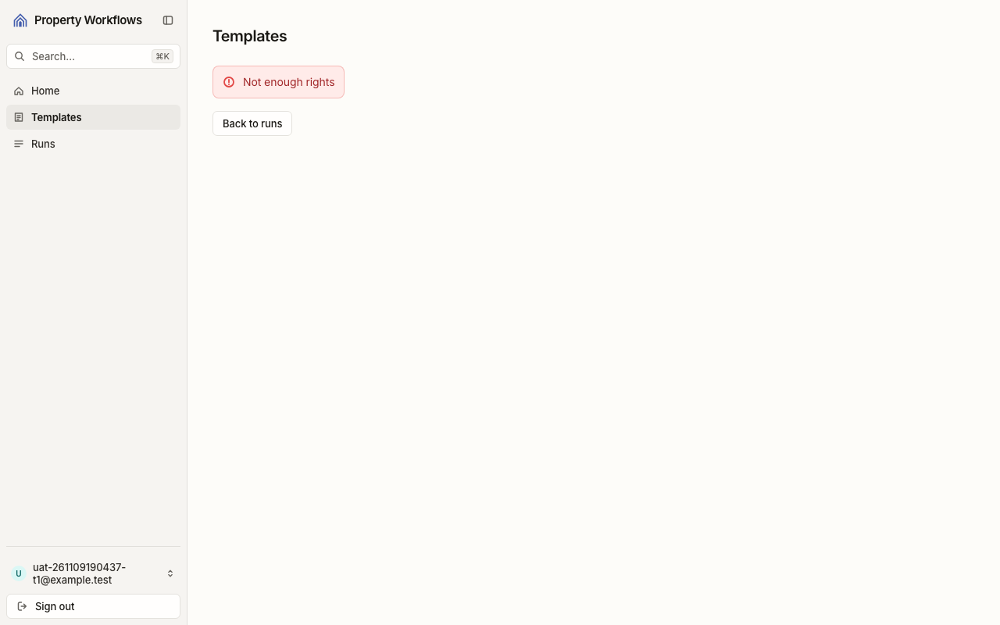
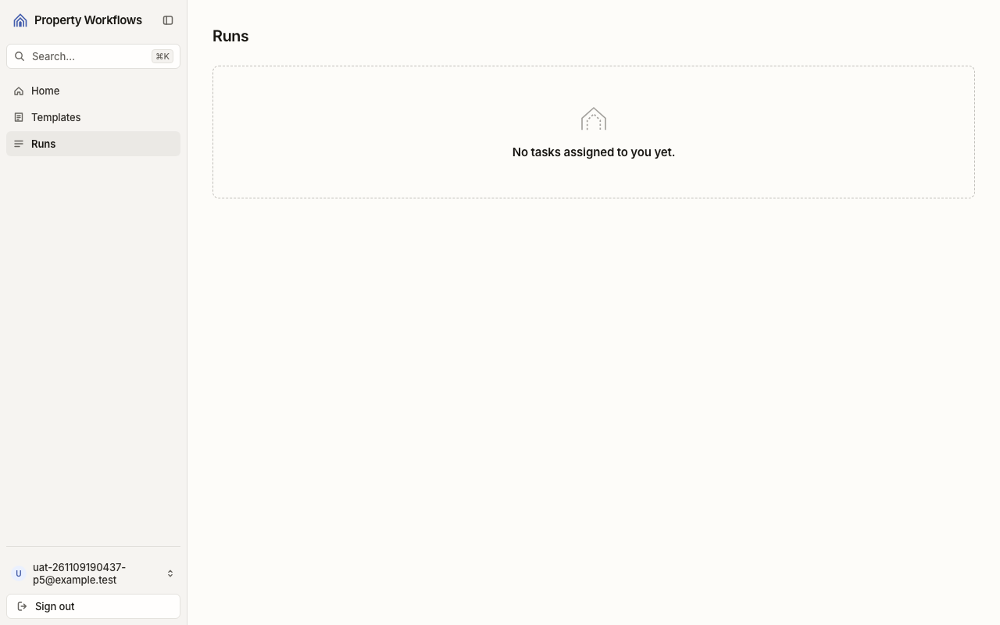
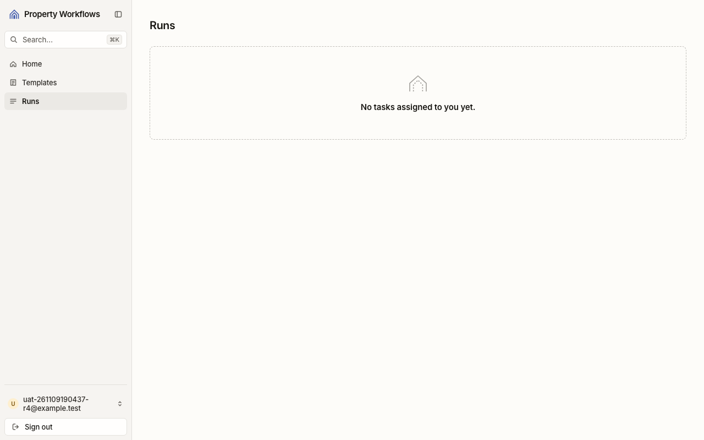

# Звіт UAT — 09.11.2026

- **Застосунок:** https://2026-quitcode-09-software-factory-h.vercel.app (/api/health: коміт `6eeb080`)
- **Код тестів:** `main` @ `6eeb080`
- **Прогін:** 09.11.2026, 21:04 (Київ), Playwright 142.4 с; AC: 10 — PASS 9, FAIL 0, NEEDS-HUMAN 1
- **Рецензент:** `claude-haiku-5-5`; суперечки → `claude-sonnet-5-5`. Разом за розбір: $0.8504 (ціни API; за підпискою — у межах ліміту плану)
- **Прибирання:** синтетичних uat-*@example.test видалено 12, лишилось 0, їхніх рядків, що лишились: 0
- **Відео й траси:** не в git — `test-results/` локально або артефакт CI; трасу відкриває `npx playwright show-trace <trace.zip>`

| AC | Перевірки | Агент | Підсумок | Чому | Playwright | Розбір |
|---|---|---|---|---|---|---|
| AC-VENDOR-01 | пройшли | Haiku: PASS | **PASS** | R6: перевірки, агент і цитати збігаються | 19.2 с | $0.0853, 13.0 с |
| AC-VENDOR-02 | пройшли | Haiku: NEEDS-HUMAN, Sonnet: NEEDS-HUMAN | **NEEDS-HUMAN** | R3: перевірки пройшли, агент не погоджується — вирішує людина | 10.0 с | $0.1262, 28.7 с |
| AC-VENDOR-03 | пройшли | Haiku: NEEDS-HUMAN, Sonnet: PASS | **PASS** | R6: перевірки, агент і цитати збігаються | 7.9 с | $0.1222, 20.7 с |
| AC-VENDOR-04 | пройшли | Haiku: PASS | **PASS** | R6: перевірки, агент і цитати збігаються | 10.2 с | $0.0794, 18.6 с |
| AC-VENDOR-05 | пройшли | Haiku: PASS | **PASS** | R6: перевірки, агент і цитати збігаються | 12.7 с | $0.0537, 8.2 с |
| AC-VENDOR-06 | пройшли | Haiku: NEEDS-HUMAN, Sonnet: PASS | **PASS** | R6: перевірки, агент і цитати збігаються | 7.5 с | $0.0917, 19.3 с |
| AC-VENDOR-07 | пройшли | Haiku: PASS | **PASS** | R6: перевірки, агент і цитати збігаються | 12.8 с | $0.0530, 8.2 с |
| AC-VENDOR-08 | пройшли | Haiku: NEEDS-HUMAN, Sonnet: PASS | **PASS** | R6: перевірки, агент і цитати збігаються | 6.4 с | $0.0919, 20.6 с |
| AC-VENDOR-09 | пройшли | Haiku: NEEDS-HUMAN, Sonnet: PASS | **PASS** | R6: перевірки, агент і цитати збігаються | 8.7 с | $0.0934, 22.1 с |
| AC-VENDOR-10 | пройшли | Haiku: PASS | **PASS** | R6: перевірки, агент і цитати збігаються | 8.5 с | $0.0536, 8.6 с |

## AC-VENDOR-01 — PASS

**Тест:** AC-VENDOR-01: менеджер A запускає «Tenant move-in» для «Apartment 12, move-in» і призначає підрядника V задачам 3 і 4 — задачі 3 і 4 на V, задачі 1, 2 і 5 на A

**Критерій** (requirements/39-assign-a-vendor-own-tasks.md):

> AC-VENDOR-01: Given manager A, vendor V and the template "Tenant move-in" with 5 tasks. When A launches the template for the case "Apartment 12, move-in" and assigns V as the assignee of tasks 3 and 4. Then tasks 3 and 4 have V as the assignee, and tasks 1, 2 and 5 have A.

**Кроки:** ✔ Дано: менеджер A, підрядник V і шаблон «Tenant move-in» з 5 задачами → ✔ Коли: A запускає шаблон для випадку «Apartment 12, move-in» і призначає V виконавцем задач 3 і 4 → ✔ Тоді: tasks 3 and 4 have V as the assignee, and tasks 1, 2 and 5 have A.

**Агент (claude-haiku-5-5, PASS):** На кадрі видно сторінку «Apartment 12, move-in» з написом «Run launched.» і п'ятьма задачами: у двох останніх (Order cleaning, Hand over the keys) виконавець uat-261109190437-p4@example.test, у трьох інших (Sign the lease agreement, Inspect the apartment, Record meter readings) — uat-261109190437-p1@example.test. Номери 1–5 на екрані не показані; відповідність вважаю за порядком відображення задач (3 і 4 — це другий блок і перша задача «Move-in day»), тож перевірка номерів спирається на порядок шаблону, якого на кадрі немає.

**Цитати агента, звірені зі сторінкою (aria):**
- «Order cleaning» — є на сторінці
- «uat-261109190437-p4@example.test» — є на сторінці
- «Hand over the keys» — є на сторінці
- «uat-261109190437-p4@example.test» — є на сторінці
- «Sign the lease agreement» — є на сторінці
- «uat-261109190437-p1@example.test» — є на сторінці
- «Inspect the apartment» — є на сторінці
- «uat-261109190437-p1@example.test» — є на сторінці
- «Record meter readings» — є на сторінці
- «uat-261109190437-p1@example.test» — є на сторінці

**Правило:** R6: перевірки, агент і цитати збігаються

**Відео:** `test-results/artifacts/vendor-assign-AC-VENDOR-01-fbf7e--4-на-V-задачі-1-2-і-5-на-A-chromium/video.webm` · **траса:** `test-results/artifacts/vendor-assign-AC-VENDOR-01-fbf7e--4-на-V-задачі-1-2-і-5-на-A-chromium/trace.zip` (не в git)

**Рішення PM:** ☐ приймаю · ☐ відхилення від вимог (issue «Відхилення від вимог: AC-VENDOR-01 — …») · @login: ____

## AC-VENDOR-02 — NEEDS-HUMAN

**Тест:** AC-VENDOR-02: менеджер A у виборі виконавця під час запуску бачить email менеджера B, адміністратора і підрядника V — без імен, ролей та інших даних профілю

**Критерій** (requirements/39-assign-a-vendor-own-tasks.md):

> AC-VENDOR-02: Given managers A and B, an administrator and vendor V, and A launching a template. When A opens the assignee picker. Then A sees the emails of B, of the administrator and of V, and no names, roles or other profile data.

**Кроки:** ✔ Дано: менеджери A і B, адміністратор і підрядник V, і A запускає шаблон → ✔ Коли: A відкриває вибір виконавця → ✔ Тоді: A sees the emails of B, of the administrator and of V, and no names, roles or other profile data.

**Агент (claude-sonnet-5-5, NEEDS-HUMAN):** На кадрі відкритий список вибору виконавця: uat-261109190437-p1 (run manager), admin.c, admin, manager.a, manager.b, manager.c, manager.d, pm-admin, а далі ще один рядок обрізано. Адрес p2, p3 і p4 серед видимих рядків немає. Вони можуть бути нижче в списку, що прокручується, але з кадру цього не підтвердити, тому потрібна ручна перевірка.

Haiku сказав NEEDS-HUMAN, тож розбір повторив Sonnet; рішення агента — за Sonnet.

**Агент бачить вади:**
- На кадрі немає жодного з потрібних email (p2, p3, p4). Список відкритий, але обрізаний знизу: останній рядок видно лише частково, тож решту варіантів не видно.
- У списку видно інші адреси (admin.c, admin, manager.a–d, pm-admin), які не збігаються з очікуваними p2/p3/p4.

**Правило:** R3: перевірки пройшли, агент не погоджується — вирішує людина

**Відео:** `test-results/artifacts/vendor-assign-AC-VENDOR-02-5832e-олей-та-інших-даних-профілю-chromium/video.webm` · **траса:** `test-results/artifacts/vendor-assign-AC-VENDOR-02-5832e-олей-та-інших-даних-профілю-chromium/trace.zip` (не в git)

**Рішення PM:** ☐ приймаю · ☐ відхилення від вимог (issue «Відхилення від вимог: AC-VENDOR-02 — …») · @login: ____

## AC-VENDOR-03 — PASS

**Тест:** AC-VENDOR-03: підрядник V (2 задачі в «Apartment 12, move-in», жодної в «Apartment 14, repair») відкриває список запусків — бачить лише «Apartment 12, move-in» зі статусом запуску й «Your tasks: 0 of 2 done»; «Apartment 14, repair» не бачить

**Критерій** (requirements/39-assign-a-vendor-own-tasks.md):

> AC-VENDOR-03: Given vendor V who is the assignee of 2 tasks in the run "Apartment 12, move-in" and of no task in the run "Apartment 14, repair". When V opens the list of runs. Then V sees only the run "Apartment 12, move-in" with its run status and "Your tasks: 0 of 2 done", and does not see "Apartment 14, repair".

**Кроки:** ✔ Дано: підрядник V — виконавець 2 задач у запуску «Apartment 12, move-in» і жодної задачі в запуску «Apartment 14, repair» → ✔ Коли: V відкриває список запусків → ✔ Тоді: V sees only the run "Apartment 12, move-in" with its run status and "Your tasks: 0 of 2 done", and does not see "Apartment 14, repair".

**Агент (claude-sonnet-5-5, PASS):** На сторінці Runs у списку лише один запуск «Apartment 12, move-in» зі статусом «in progress» і написом «Your tasks: 0 of 2 done». «Apartment 14, repair» на кадрі відсутній.

Haiku сказав NEEDS-HUMAN, тож розбір повторив Sonnet; рішення агента — за Sonnet.

**Цитати агента, звірені зі сторінкою (aria):**
- «Apartment 12, move-in» — є на сторінці
- «in progress» — є на сторінці
- «Your tasks: 0 of 2 done» — є на сторінці
- «Apartment 12, move-in» — є на сторінці

**Правило:** R6: перевірки, агент і цитати збігаються

**Відео:** `test-results/artifacts/vendor-runs-AC-VENDOR-03-п-f814a-rtment-14-repair»-не-бачить-chromium/video.webm` · **траса:** `test-results/artifacts/vendor-runs-AC-VENDOR-03-п-f814a-rtment-14-repair»-не-бачить-chromium/trace.zip` (не в git)

**Рішення PM:** ☐ приймаю · ☐ відхилення від вимог (issue «Відхилення від вимог: AC-VENDOR-03 — …») · @login: ____

## AC-VENDOR-04 — PASS

**Тест:** AC-VENDOR-04: підрядник V (виконавець задач 3 і 4 запуску «Apartment 12, move-in» з 5 задачами) відкриває запуск — бачить рівно задачі 3 і 4 з назвою, секцією, «required»/«optional» і статусом; не бачить задач 1, 2 і 5, email інших користувачів і прогресу всього запуску

**Критерій** (requirements/39-assign-a-vendor-own-tasks.md):

> AC-VENDOR-04: Given vendor V who is the assignee of tasks 3 and 4 in the run "Apartment 12, move-in" (5 tasks). When V opens this run. Then V sees exactly tasks 3 and 4, each with its name, its section, the mark "required" or "optional" and its status, and does not see tasks 1, 2 and 5, the emails of other users or the progress of the whole run.

**Кроки:** ✔ Дано: підрядник V — виконавець задач 3 і 4 у запуску «Apartment 12, move-in» з 5 задачами → ✔ Коли: V відкриває цей запуск → ✔ Тоді: V sees exactly tasks 3 and 4, each with its name, its section, the mark "required" or "optional" and its status, and does not see tasks 1, 2 and 5, the emails of other users or the progress of the whole run.

**Агент (claude-haiku-5-5, PASS):** На кадрі frame-then-1.png видно рівно дві задачі з правильними назвами, секціями, позначками «optional»/«required» і статусами «to do»; задач «Sign the lease agreement», «Inspect the apartment», «Record meter readings» немає. Email q1 і панелі «Details» не видно, єдиний лічильник — «Your tasks: 0 of 2 done». У сайдбарі показано email q2 (ймовірно, самого V, а не іншого користувача), а бейдж «in progress» — статус запуску без лічильника N of M; обидва моменти врахував як не порушення.

**Цитати агента, звірені зі сторінкою (aria):**
- «Before move-in» — є на сторінці
- «Order cleaning» — є на сторінці
- «optional» — є на сторінці
- «to do» — є на сторінці
- «Move-in day» — є на сторінці
- «Hand over the keys» — є на сторінці
- «required» — є на сторінці
- «to do» — є на сторінці
- «Order cleaning» — є на сторінці
- «Hand over the keys» — є на сторінці
- «uat-261109190437-q2@example.test» — є на сторінці
- «Your tasks: 0 of 2 done» — є на сторінці

**Правило:** R6: перевірки, агент і цитати збігаються

**Відео:** `test-results/artifacts/vendor-tasks-AC-VENDOR-04--3609b-в-і-прогресу-всього-запуску-chromium/video.webm` · **траса:** `test-results/artifacts/vendor-tasks-AC-VENDOR-04--3609b-в-і-прогресу-всього-запуску-chromium/trace.zip` (не в git)

**Рішення PM:** ☐ приймаю · ☐ відхилення від вимог (issue «Відхилення від вимог: AC-VENDOR-04 — …») · @login: ____

## AC-VENDOR-05 — PASS

**Тест:** AC-VENDOR-05: підрядник V позначає свою задачу 3 «to do» (не остання обов'язкова) у «Apartment 12, move-in» — задача 3 має статус «done», V бачить «Your tasks: 1 of 2 done»

**Критерій** (requirements/39-assign-a-vendor-own-tasks.md):

> AC-VENDOR-05: Given vendor V who is the assignee of task 3 with status "to do", which is not the last required task of the run "Apartment 12, move-in". When V marks task 3 as done. Then task 3 has status "done", and V sees "Your tasks: 1 of 2 done".

**Кроки:** ✔ Дано: підрядник V — виконавець задачі 3 «to do», яка не є останньою обов'язковою задачею запуску «Apartment 12, move-in» → ✔ Коли: V позначає задачу 3 виконаною → ✔ Тоді: task 3 has status "done", and V sees "Your tasks: 1 of 2 done".

**Агент (claude-haiku-5-5, PASS):** На кадрі frame-then-1.png у блоку «Before move-in» задача «Order cleaning» має бейдж «done», а вгорі написано «Your tasks: 1 of 2 done». Обидві видимі частини «Тоді» присутні дослівно. Частина про статус у базі та done_by не оцінювалася, бо це поза кадрами.

**Цитати агента, звірені зі сторінкою (aria):**
- «Order cleaning» — є на сторінці
- «optional» — є на сторінці
- «done» — є на сторінці
- «Your tasks: 1 of 2 done» — є на сторінці

**Правило:** R6: перевірки, агент і цитати збігаються

**Відео:** `test-results/artifacts/vendor-tasks-AC-VENDOR-05--5135a-ть-«Your-tasks-1-of-2-done»-chromium/video.webm` · **траса:** `test-results/artifacts/vendor-tasks-AC-VENDOR-05--5135a-ть-«Your-tasks-1-of-2-done»-chromium/trace.zip` (не в git)

**Рішення PM:** ☐ приймаю · ☐ відхилення від вимог (issue «Відхилення від вимог: AC-VENDOR-05 — …») · @login: ____

## AC-VENDOR-06 — PASS

**Тест:** AC-VENDOR-06: запуск «Apartment 14, repair», у якому підрядник V не має задач; V відкриває сторінку цього запуску за прямим посиланням — бачить «Run not found» і жодної задачі запуску

**Критерій** (requirements/39-assign-a-vendor-own-tasks.md):

> AC-VENDOR-06: Given the run "Apartment 14, repair" in which vendor V has no task. When V opens the page of this run by a direct link. Then V sees the message "Run not found" and none of the tasks of the run.

**Кроки:** ✔ Дано: запуск «Apartment 14, repair», у якому підрядник V не має задач → ✔ Коли: V відкриває сторінку цього запуску за прямим посиланням → ✔ Тоді: V sees the message "Run not found" and none of the tasks of the run.

**Агент (claude-sonnet-5-5, PASS):** На кадрі видно повідомлення «Run not found» і кнопку «Back to runs». Жодної з п'яти назв задач на екрані немає, область вмісту порожня, окрім блоку з повідомленням. Для другої частини цитатою є лише повідомлення, бо відсутність задач підтверджується відсутністю тексту.

Haiku сказав NEEDS-HUMAN, тож розбір повторив Sonnet; рішення агента — за Sonnet.

**Цитати агента, звірені зі сторінкою (aria):**
- «Run not found» — є на сторінці
- «Run not found» — є на сторінці

**Правило:** R6: перевірки, агент і цитати збігаються

**Відео:** `test-results/artifacts/vendor-runs-AC-VENDOR-06-з-49a9c-nd»-і-жодної-задачі-запуску-chromium/video.webm` · **траса:** `test-results/artifacts/vendor-runs-AC-VENDOR-06-з-49a9c-nd»-і-жодної-задачі-запуску-chromium/trace.zip` (не в git)

**Рішення PM:** ☐ приймаю · ☐ відхилення від вимог (issue «Відхилення від вимог: AC-VENDOR-06 — …») · @login: ____

## AC-VENDOR-07 — PASS

**Тест:** AC-VENDOR-07: у «Apartment 12, move-in» задача 1 — на менеджері A, задачі 3 і 4 — на підряднику V; V напряму, оминаючи сторінки, позначає задачу 1 виконаною — задача 1 лишається «to do»

**Критерій** (requirements/39-assign-a-vendor-own-tasks.md):

> AC-VENDOR-07: Given the run "Apartment 12, move-in" in which task 1 is assigned to manager A and tasks 3 and 4 to vendor V. When V tries to mark task 1 as done directly, bypassing the pages of the application. Then task 1 stays "to do".

**Кроки:** ✔ Дано: запуск «Apartment 12, move-in», у якому задача 1 призначена менеджеру A, а задачі 3 і 4 — підряднику V → ✔ Коли: V намагається позначити задачу 1 виконаною напряму, оминаючи сторінки застосунку (rpc complete_task від імені V) → ✔ Тоді: task 1 stays "to do".

**Агент (claude-haiku-5-5, PASS):** На кадрі сторінка запуску «Apartment 12, move-in» з першою задачею «Sign the lease agreement» (required), поруч із нею видно статус «to do» і кнопку «Mark as done». Сесія відкрита під користувачем uat-261109190437-q1@example.test, який є Run manager у блоці Details, тож це сторінка менеджера A. Частини про NOT_ALLOWED і стан бази не з кадрів, тому не оцінювалися.

**Цитати агента, звірені зі сторінкою (aria):**
- «Sign the lease agreement» — є на сторінці
- «to do» — є на сторінці

**Правило:** R6: перевірки, агент і цитати збігаються

**Відео:** `test-results/artifacts/vendor-tasks-AC-VENDOR-07--00e20--задача-1-лишається-«to-do»-chromium/video.webm` · **траса:** `test-results/artifacts/vendor-tasks-AC-VENDOR-07--00e20--задача-1-лишається-«to-do»-chromium/trace.zip` (не в git)

**Рішення PM:** ☐ приймаю · ☐ відхилення від вимог (issue «Відхилення від вимог: AC-VENDOR-07 — …») · @login: ____

## AC-VENDOR-08 — PASS

**Тест:** AC-VENDOR-08: підрядник V відкриває список шаблонів за прямим посиланням — бачить «Not enough rights» і жодного шаблону

**Критерій** (requirements/39-assign-a-vendor-own-tasks.md):

> AC-VENDOR-08: Given vendor V signed in. When V opens the list of templates by a direct link. Then V sees the message "Not enough rights" and no template.

**Кроки:** ✔ Дано: підрядник V увійшов; у агенції є збережені шаблони (зокрема «Tenant move-in») → ✔ Коли: V відкриває список шаблонів за прямим посиланням /templates → ✔ Тоді: V sees the message "Not enough rights" and no template.

**Агент (claude-sonnet-5-5, PASS):** На сторінці «Templates» видно червоне повідомлення «Not enough rights» і кнопку «Back to runs». Назв шаблонів «Tenant move-in» та «Apartment repair» на кадрі немає, список порожній.

Haiku сказав NEEDS-HUMAN, тож розбір повторив Sonnet; рішення агента — за Sonnet.

**Цитати агента, звірені зі сторінкою (aria):**
- «Not enough rights» — є на сторінці
- «Templates» — є на сторінці
- «Not enough rights» — є на сторінці
- «Back to runs» — є на сторінці

**Правило:** R6: перевірки, агент і цитати збігаються

**Відео:** `test-results/artifacts/vendor-templates-AC-VENDOR-1b4c6-h-rights»-і-жодного-шаблону-chromium/video.webm` · **траса:** `test-results/artifacts/vendor-templates-AC-VENDOR-1b4c6-h-rights»-і-жодного-шаблону-chromium/trace.zip` (не в git)

**Рішення PM:** ☐ приймаю · ☐ відхилення від вимог (issue «Відхилення від вимог: AC-VENDOR-08 — …») · @login: ____

## AC-VENDOR-09 — PASS

**Тест:** AC-VENDOR-09: підрядник V напряму, оминаючи сторінки, запускає «Tenant move-in» — запуск не створено, список запусків не змінився

**Критерій** (requirements/39-assign-a-vendor-own-tasks.md):

> AC-VENDOR-09: Given vendor V signed in and the template "Tenant move-in" with current version 1. When V tries to launch this template directly, bypassing the pages of the application. Then no run is created, and the list of runs does not change.

**Кроки:** ✔ Дано: підрядник V увійшов і шаблон «Tenant move-in» має поточну версію → ✔ Коли: V намагається запустити цей шаблон напряму, оминаючи сторінки застосунку (rpc launch_run від імені V) → ✔ Тоді: no run is created, and the list of runs does not change.

**Агент (claude-sonnet-5-5, PASS):** На сторінці Runs видно порожній стан «No tasks assigned to you yet.», запуску «Apartment 12, move-in» у списку немає. Кадру «до» немає, тож порівняння спирається лише на відсутність цього запуску. Сторінка показує завдання, призначені користувачу, тому повну картину запусків підтверджують перевірки не з кадрів.

Haiku сказав NEEDS-HUMAN, тож розбір повторив Sonnet; рішення агента — за Sonnet.

**Цитати агента, звірені зі сторінкою (aria):**
- «Runs» — є на сторінці
- «No tasks assigned to you yet.» — є на сторінці

**Правило:** R6: перевірки, агент і цитати збігаються

**Відео:** `test-results/artifacts/vendor-assign-AC-VENDOR-09-9d99c-список-запусків-не-змінився-chromium/video.webm` · **траса:** `test-results/artifacts/vendor-assign-AC-VENDOR-09-9d99c-список-запусків-не-змінився-chromium/trace.zip` (не в git)

**Рішення PM:** ☐ приймаю · ☐ відхилення від вимог (issue «Відхилення від вимог: AC-VENDOR-09 — …») · @login: ____

## AC-VENDOR-10 — PASS

**Тест:** AC-VENDOR-10: підрядник V без жодної задачі відкриває список запусків — бачить «No tasks assigned to you yet.» і не бачить порожньої таблиці

**Критерій** (requirements/39-assign-a-vendor-own-tasks.md):

> AC-VENDOR-10: Given vendor V to whom no task is assigned. When V opens the list of runs. Then V sees the message "No tasks assigned to you yet." and no empty table.

**Кроки:** ✔ Дано: підрядник V, якому не призначено жодної задачі → ✔ Коли: V відкриває список запусків → ✔ Тоді: V sees the message "No tasks assigned to you yet." and no empty table.

**Агент (claude-haiku-5-5, PASS):** На кадрі /runs видно повідомлення «No tasks assigned to you yet.» у пунктирній рамці-заглушці з іконкою. Таблиці з заголовками стовпців або рядками немає, тож частина «немає порожньої таблиці» виконана. Відсутність елемента table у DOM і посилання «Launch a template» не оцінювалися, бо це не видно на кадрі.

**Цитати агента, звірені зі сторінкою (aria):**
- «No tasks assigned to you yet.» — є на сторінці
- «No tasks assigned to you yet.» — є на сторінці

**Правило:** R6: перевірки, агент і цитати збігаються

**Відео:** `test-results/artifacts/vendor-runs-AC-VENDOR-10-п-45a93-не-бачить-порожньої-таблиці-chromium/video.webm` · **траса:** `test-results/artifacts/vendor-runs-AC-VENDOR-10-п-45a93-не-бачить-порожньої-таблиці-chromium/trace.zip` (не в git)

**Рішення PM:** ☐ приймаю · ☐ відхилення від вимог (issue «Відхилення від вимог: AC-VENDOR-10 — …») · @login: ____

## Як читати підсумок

- **PASS** — автоматичні перевірки пройшли, агент-рецензент погодився з кадром, а кожну його цитату знайдено на сторінці.
- **FAIL** — впала автоматична перевірка. Агент цього не перекриває: невидимі вади (буфер обміну, база) він на кадрі не побачить.
- **NEEDS-HUMAN** — перевірки зелені, але агент не погодився або його цитати немає на сторінці. Часто це слабкий тест або розбіжність між текстом AC і тестом — питання до PM, а не обов'язково вада продукту.

Правила: R1: перевірка впала — FAIL завжди, агент не перекриває; R2: немає вердикту агента або кадру; R3: перевірки пройшли, агент не погоджується — вирішує людина; R4: цитати агента немає на сторінці (aria) — не підтверджено; R5: помилка сторінки або 5xx під час сценарію; R6: перевірки, агент і цитати збігаються.
