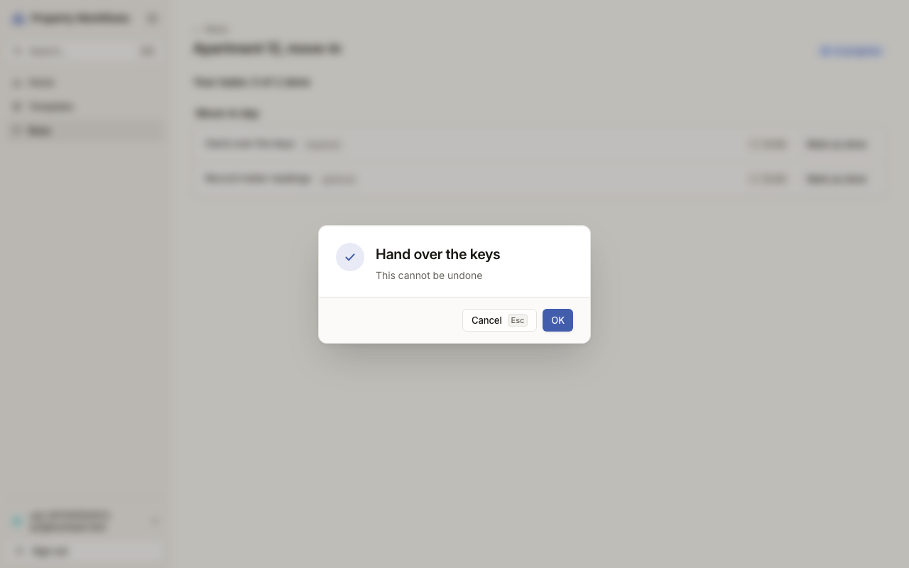

# Звіт UAT — 09.11.2026

- **Застосунок:** https://2026-quitcode-09-software-factory-h.vercel.app (/api/health: коміт `cf98a78`)
- **Код тестів:** `tests-first/vendor-last-required` @ `cf98a78`
- **Прогін:** 09.11.2026, 21:28 (Київ), Playwright 28.7 с; AC: 1 — PASS 0, FAIL 1, NEEDS-HUMAN 0
- **Рецензент:** `claude-haiku-5-5`; суперечки → `claude-sonnet-5-5`. Разом за розбір: $0.0553 (ціни API; за підпискою — у межах ліміту плану)
- **Прибирання:** синтетичних uat-*@example.test видалено 2, лишилось 0, їхніх рядків, що лишились: 0
- **Відео й траси:** не в git — `test-results/` локально або артефакт CI; трасу відкриває `npx playwright show-trace <trace.zip>`

| AC | Перевірки | Агент | Підсумок | Чому | Playwright | Розбір |
|---|---|---|---|---|---|---|
| AC-VENDOR-05 | впали | Haiku: NEEDS-HUMAN | **FAIL** | R1: перевірка впала — FAIL завжди, агент не перекриває | 13.3 с | $0.0553, 9.2 с |

## AC-VENDOR-05 — FAIL

**Тест:** AC-VENDOR-05: підрядник V позначає свою задачу 3 «to do» (не остання обов'язкова) у «Apartment 12, move-in» — задача 3 має статус «done», V бачить «Your tasks: 1 of 2 done»

**Критерій** (requirements/39-assign-a-vendor-own-tasks.md):

> AC-VENDOR-05: Given vendor V who is the assignee of task 3 with status "to do", which is not the last required task of the run "Apartment 12, move-in". When V marks task 3 as done. Then task 3 has status "done", and V sees "Your tasks: 1 of 2 done".



**Кроки:** ✔ Дано: підрядник V — виконавець задачі 3 «to do», яка не є останньою обов'язковою задачею запуску «Apartment 12, move-in» → ✔ Коли: V позначає задачу 3 виконаною → ✘ Тоді: task 3 has status "done", and V sees "Your tasks: 1 of 2 done".

**Перевірка впала:**

```
Error: expect(locator).toBeVisible() failed

Locator: getByRole('main').getByTestId('run-task').first().getByText('done', { exact: true })
Expected: visible
Timeout: 5000ms
Error: element(s) not found

Call log:
```

**Агент (claude-haiku-5-5, NEEDS-HUMAN):** На кадрі видно діалог підтвердження «Hand over the keys» з текстом «This cannot be undone» і кнопками Cancel та OK. Під діалогом сторінка запуску «Apartment 12, move-in» розмита, тож рядок «Your tasks» і статус задачі не читаються. Потрібен кадр після натискання OK або чіткий знімок сторінки без діалогу.

**Агент бачить вади:**
- Кадр показує діалог підтвердження «Hand over the keys» з кнопками Cancel і OK, а не результат після дії. Кадр зроблено до підтвердження, тож стан «done» на ньому не видно.
- Фон сторінки розмитий: текст «Your tasks: 1 of 2 done» і статус задачі 3 нерозбірливі, тому цитату взяти не можна.

**Правило:** R1: перевірка впала — FAIL завжди, агент не перекриває

**Відео:** `test-results/artifacts/vendor-tasks-AC-VENDOR-05--5135a-ть-«Your-tasks-1-of-2-done»-chromium/video.webm` · **траса:** `test-results/artifacts/vendor-tasks-AC-VENDOR-05--5135a-ть-«Your-tasks-1-of-2-done»-chromium/trace.zip` (не в git)

**Рішення PM:** ☐ приймаю · ☐ відхилення від вимог (issue «Відхилення від вимог: AC-VENDOR-05 — …») · @login: ____

## Як читати підсумок

- **PASS** — автоматичні перевірки пройшли, агент-рецензент погодився з кадром, а кожну його цитату знайдено на сторінці.
- **FAIL** — впала автоматична перевірка. Агент цього не перекриває: невидимі вади (буфер обміну, база) він на кадрі не побачить.
- **NEEDS-HUMAN** — перевірки зелені, але агент не погодився або його цитати немає на сторінці. Часто це слабкий тест або розбіжність між текстом AC і тестом — питання до PM, а не обов'язково вада продукту.

Правила: R1: перевірка впала — FAIL завжди, агент не перекриває; R2: немає вердикту агента або кадру; R3: перевірки пройшли, агент не погоджується — вирішує людина; R4: цитати агента немає на сторінці (aria) — не підтверджено; R5: помилка сторінки або 5xx під час сценарію; R6: перевірки, агент і цитати збігаються.
